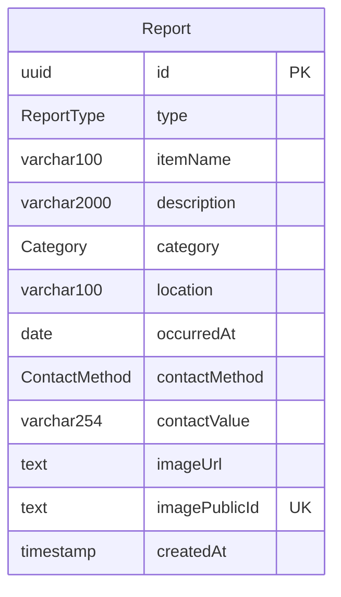

# Database design

PostgreSQL menyimpan laporan melalui Prisma ORM. Tidak ada akun pada requirement minimum, sehingga satu tabel `Report` cukup; tidak ada relasi palsu ke User. Metode kontak merupakan enum dan satu nilai yang dipilih reporter, bukan tabel kumpulan data privat.

| Field         | Prisma / PostgreSQL       | Input / output                  | Aturan                                                          |
| ------------- | ------------------------- | ------------------------------- | --------------------------------------------------------------- |
| id            | String @db.Uuid / UUID PK | Generated; public               | UUID v4 default di Prisma                                       |
| type          | ReportType enum           | Required; public                | LOST atau FOUND                                                 |
| itemName      | String @db.VarChar(100)   | Required; public                | Trim, 3–100 karakter                                            |
| description   | String @db.VarChar(2000)  | Required; public                | Trim, 10–2000 karakter                                          |
| category      | Category enum             | Required; public                | ELECTRONICS, ID_CARD, BOTTLE, CLOTHING, ACCESSORIES, OTHER      |
| location      | String @db.VarChar(100)   | Required; public                | Trim, 2–100; suggestions bukan FK                               |
| occurredAt    | DateTime @db.Date         | Required; public YYYY-MM-DD     | Tanggal kalender valid, bukan masa depan; konversi UTC midnight |
| contactMethod | ContactMethod enum        | Required; detail public only    | EMAIL atau WHATSAPP                                             |
| contactValue  | String @db.VarChar(254)   | Required; detail public only    | Email valid atau E.164 + dan 8–15 digit                         |
| imageUrl      | String? / TEXT            | Server generated; public        | Cloudinary secure_url atau null                                 |
| imagePublicId | String? @unique / TEXT    | Server generated; internal      | Referensi cleanup Cloudinary, tidak dipublikasikan              |
| createdAt     | DateTime @default(now())  | Generated; public ISO timestamp | Tidak boleh dikirim client                                      |

Schema final ada di `server/prisma/schema.prisma`. Migrasi SQL `20261125000000_init` membuat enum, tabel, constraints dan indeks. DB CHECK tambahan memastikan nama/deskripsi/lokasi tidak kosong dan imageUrl/imagePublicId sama-sama null atau sama-sama terisi. Nilai UUID diciptakan Prisma; default DB untuk UUID tidak dibutuhkan.

## Indeks dan query

`[createdAt,id]` mendukung urutan terbaru dan tie-breaker deterministik. `[type,category,location]` membantu kombinasi equality filters; bukan jaminan setiap query terindeks. Search memakai `contains` case-insensitive pada itemName dan exact case-insensitive pada lokasi. Ini cukup untuk skala project; `contains` dengan leading wildcard dapat full scan. Pada skala besar, pertimbangkan pg_trgm/GiN, indeks case-insensitive dan cursor pagination setelah pengukuran.

Filter digabung AND. `findMany` dan `count` dalam transaksi RepeatableRead menghasilkan metadata yang konsisten per request. Offset pagination dapat bergeser antar request ketika ada laporan baru; itu diterima pada MVP. Tidak menerima sort/column SQL dari client; semua query melalui Prisma.

## Setup dan perubahan

1. Buat database development/test, set `server/.env` atau env shell. Password URL harus di-percent-encode bila berisi karakter khusus.
2. `npm run db:generate`; `npm run db:migrate` menjalankan migrasi committed.
3. `npm run db:seed` bila butuh data demo, tanpa truncate atau overwrite record yang sudah ada.
4. Perubahan schema: gunakan `npm run db:dev -w server -- --name meaningful_change` hanya di development; review SQL dan commit folder migrasi.
5. Production: backup dulu sesuai provider; jalankan `npm run db:migrate`, bukan `migrate dev` atau reset.
6. `npm run test:db` dengan TEST_DATABASE_URL menguji tulis → restart API → baca ulang.

Dokumentasi Prisma yang mendasari workflow versi 7: [upgrade and driver adapter configuration](https://www.prisma.io/docs/guides/upgrade-prisma-orm/v7) dan [production migrations](https://www.prisma.io/docs/orm/v7/prisma-client/deployment/deploy-database-changes-with-prisma-migrate). Perintah pada proyek ini mengikuti versi 7.10.1 yang dipin, bukan CLI major terbaru. URL berada pada `server/prisma.config.js`; adapter-pg dan Prisma Client dibuat oleh `server/src/database.js`. Client JS dihasilkan ke `server/generated/client` dan tidak perlu di-commit.

## Operasional data

Docker Compose menyimpan volume `postgres_data`; restart container mempertahankan data. `docker compose down -v` menghapus volume dan jangan dipakai jika data ingin dipertahankan. Gunakan backup provider/pg_dump sebelum migrasi produksi. Tidak ada edit/delete publik; permintaan koreksi/penghapusan perlu ditangani operator database yang berwenang. Aset orphan perlu direkonsiliasi bila cleanup provider gagal. Retensi laporan, SOP penghapusan, dan identitas operator perlu disepakati sebelum penggunaan kampus nyata.
