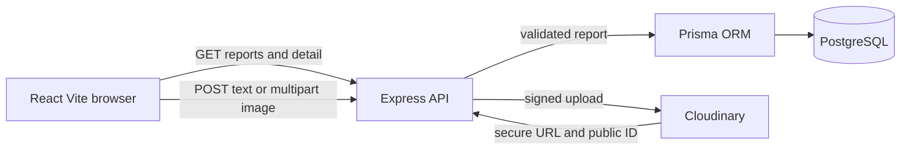

# Demo Day materials

Demo aplikasi Temu untuk Final Project Web Development RISTEK Open Class 2026. Isi nama tim dan URL aktual sebelum presentasi; jangan menampilkan kontak/data pribadi nyata pada rekaman.

## Identitas dan tautan pengumpulan

| Isian             | Nilai                              |
| ----------------- | ---------------------------------- |
| BE                | Belum diberikan                    |
| FE1               | Belum diberikan                    |
| FE2               | Belum diberikan                    |
| GitHub repository | Belum dibuat/ditautkan             |
| Frontend URL      | Belum deployed                     |
| Backend base URL  | Belum deployed                     |
| Video demo        | Belum direkam                      |
| Dokumentasi API   | docs/API.md                        |
| Database/migrasi  | server/prisma dan docs/DATABASE.md |

## Naskah presentasi 5 menit

**0:00–0:40 — Masalah.** “Tumbler tertinggal di A206, charger hilang di sekre, dan KTM ditemukan dekat pos satpam. Pesan grup bisa tertimbun. Temu mengumpulkan laporan Lost & Found agar pemilik dan penemu punya tempat yang sama untuk saling menemukan.”

**0:40–1:30 — Pencarian.** Buka listing, jelaskan Lost/Found badges dan placeholder. Cari `tumbler`, pilih Lost, Botol minum, A206. Buka detail dan tunjukkan tanggal kejadian serta kontak email pilihan pelapor. Reset filter dan buka halaman kedua.

**1:30–2:40 — Submission.** Buat Found “Payung hijau demo”, kategori Aksesori, lokasi Perpustakaan, tanggal hari ini/sebelumnya, deskripsi yang aman. Pilih WhatsApp menggunakan nomor demo internasional. Coba form kosong atau kontak salah, lalu perbaiki. Upload gambar benda tanpa identitas pribadi jika Cloudinary sudah dikonfigurasi; kalau belum, jelaskan status tersebut dan demo laporan tanpa foto secara jujur. Tunjukkan success dan detail baru.

**2:40–3:30 — Integrasi dan database.** Jelaskan FE memanggil Express API, input divalidasi sebelum tersimpan melalui Prisma ke PostgreSQL. Cloudinary menyimpan file; DB hanya URL dan public ID. Restart API lalu buka laporan yang baru dibuat. Gunakan hasil `npm run test:db` bila restart manual tidak praktis.

**3:30–4:20 — Privasi dan kegagalan.** “Form hanya mengumpulkan satu metode kontak publik, dan listing tidak mengirim kontak. Tidak ada endpoint edit/delete publik.” Tunjukkan API response di alat pengembang atau API client. Simulasikan backend berhenti dan tunjukkan pesan gagal/retry, kemudian hidupkan kembali.

**4:20–5:00 — Pembelajaran dan penutup.** Jelaskan pembagian role dan kontribusi nyata berdasarkan commit. Sebutkan keterbatasan: belum ada login/admin, rate limiter per proses, dan fitur operasional hosting yang belum diuji bila memang belum. Tutup dengan URL/GitHub yang sudah diverifikasi, bukan URL perkiraan.

## Outline slide

1. Temu dan masalah pesan barang hilang yang tertimbun.
2. User flow pencari dan penemu; lima fitur minimum brief.
3. Arsitektur: React/Vite → Express → Prisma/PostgreSQL; Express → Cloudinary.
4. Demo listing/filter/detail/submission/persistence dan privacy.
5. Hasil checks, kontribusi tim, status deployment, dan pelajaran.

## Checklist sebelum merekam

Jalankan build/lint/tests, pastikan mode mock mati, migrasi applied, fixture/demo data aman, port bebas, dan secret tidak tampak pada screen share. Siapkan sample foto benda ≤5 MB dan kedua browser widths. Pastikan setiap anggota mampu menjelaskan bagian kode miliknya sesuai ketentuan AI Usage dalam brief. Rekam video pada perangkat/akun tim setelah URL live siap; dokumen ini merupakan materi demo, bukan klaim video/slide deck sudah direkam atau dipresentasikan.
